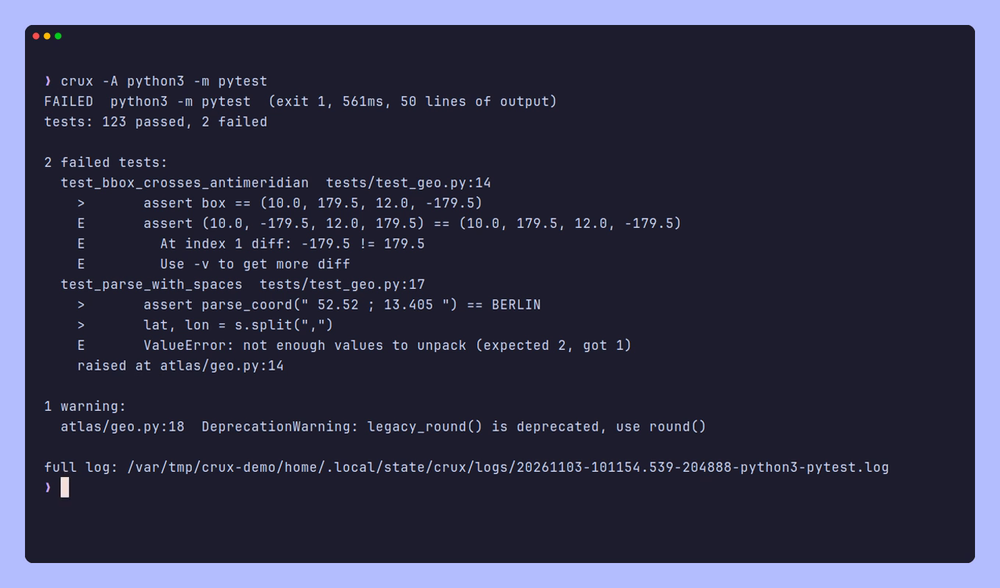

<div align="center">

# crux

Run a build or test command and see only what matters.

[](go.mod)
[](https://github.com/Vaspyyy/crux/tags)
[](LICENSE)


</div>

crux is a wrapper for build, test and lint commands. `crux cargo test` runs `cargo test`, waits for it, and prints the verdict, the test counts, and each error or failed test with its file, line and the few lines that explain it. Compile progress, hundreds of passing tests and standard-library stack frames are left out of the report but kept in a log file, so nothing is lost. The exit code is the command's own.

It was written for AI coding agents, which pay for every line of output they read, but it's just as usable at a terminal: there it shows a live status line while the command runs and prints the report in color.

## Install

```sh
go install github.com/Vaspyyy/crux@latest
```

You'll need Go 1.26 or newer (older versions fetch the right toolchain on their own). crux is a single binary with no runtime dependencies. It's developed on Linux and should work on macOS and the BSDs; Windows isn't supported.

## Usage

Put `crux` in front of the command:

```sh
crux cargo test
crux go test ./...
crux python3 -m pytest
crux npx tsc --noEmit
crux make
```

Flags go before the command; everything after the command's name belongs to the command.

| Flag | Effect |
| --- | --- |
| `-b`, `--budget N` | Roughly how many lines the report may use (default 60). |
| `-v`, `--verbose` | Stream the output while the command runs, then print the report. |
| `-r`, `--raw` | Print the whole output, cleaned of escape codes and progress bars, instead of a report. The verdict line goes to stderr. |
| `-A`, `--agent` | Plain report without colors or live status. This is the default when stdout isn't a terminal. |
| `--json` | Print one JSON document instead of the report (see [JSON](#json)). |
| `--keep-locale` | Don't switch the command to English messages. |
| `--no-log` | Don't keep the full output on disk. |
| `--no-context` | Don't read context or record the run (see [Context](#context)). `PRISM_NO_CONTEXT=1` does the same. |
| `--log` | Print the path of the latest log from the current directory and exit. |

Short flags can be combined (`crux -rv make`).

## The report



The first line is the verdict, the command, its exit code (or the signal that killed it), how long it took and how much output it produced. For test runs, a `tests:` line follows with the counts from the tool's own summary: passed, failed, errors, skipped and so on. Go without `-v` only reports packages, so crux shows `3/4 packages ok` then rather than inventing a test count.

Errors, failed tests and warnings come next, each with its location. Errors carry the code frame or the frames of a stack trace that are in your code, and failed tests carry the assertion or panic message. When three or more errors are the same (same message, and for Rust the same expected and found types) they're folded into one entry that lists every location, and warnings are folded by kind with every name listed (`unused variable [-Wunused-variable] ×2: ‘unused’, ‘y’`). Tools print paths relative to their own root, so crux looks a location's file up from the current directory, the directories make entered and the parent directories, and rewrites the path so it works from where you are. A location whose file can't be found anywhere is marked, which catches stale caches.

Under each error and failed test, crux names the function, method or type its location is in, as a [ref](#refs) that seek and recap take as is. A failed test also gets its own definition when that's a different symbol, such as a test whose assertion is in a helper:

```
2 failed tests:
  TestAdd  calc/calc_test.go:7
    in calc/calc_test.go:check
    test calc/calc_test.go:TestAdd
    got 2, want 3
  TestNoMessage  calc/
    in calc/calc_test.go:TestNoMessage
```

`in` is the innermost definition whose lines contain the location, found with fast per-language rules rather than a compiler, so it says where the line is, not what the code does. A failure without a location gets `in` with the test itself. Go tests are looked up in their package's `_test.go` files, pytest tests by their node ID or traceback header, and cargo tests (`module::tests::name`) only when exactly one function in the crate ends in `tests.name`. Files outside the repository (the standard library, installed packages), files that aren't regular files (symlinks, devices, pipes), lines outside any definition and warnings get no `in` line.

A `notes:` section says when a run did less than it seems to have done: cargo stopping at the first failing test target, a Go test panic (also one in a goroutine) ending the rest of its package, a `-run` filter that matched no test, pytest stopping after a collection error, after `-x` or on Ctrl+C, a package that didn't build.

The budget is soft and has two guarantees: the first error or failed test always keeps its explanation and its `in` line, and every error and failed test gets a line (beyond 30 of them, as many as the budget allows). The `in` lines of the others come next, then their code frames and warnings get what's left, and anything cut is announced with a count. Output crux doesn't recognise is shown whole if it's short, or summarised by its error-looking lines and its last lines if it isn't.

The full output is written to `~/.local/state/crux/logs` while the command runs, so it survives a timeout or Ctrl+C. Every run gets its own file (readable only by you), the report ends with its path, and logs are deleted after a week. `crux --log` prints the path of the latest log from the current directory and fails if there isn't one, so `less "$(crux --log)"` never opens the wrong file.

Commands run with `LC_ALL=C.UTF-8` so compiler messages are in English and look the same on every machine. `--keep-locale` turns that off.

## Refs

glint, seek, recap and crux name files, symbols and locations the same way, so anything one of them prints can be handed to another as is:

- `internal/files/files.go`: a file
- `internal/files/files.go:List`: a symbol, by its qualified name (`Repo.Open` for a method, `outer.inner` for a nested function)
- `internal/files/files.go:73`: a line (`73:5` with a column, `73-107` a range); tools that take a symbol use the innermost one containing it
- `main.go:run@b681ef1`: a symbol as it was in a commit; `lib.cpp:parse#2`: the second of two definitions with the same name

Paths are relative to the repository root. The format is specified in [Prism](https://github.com/Vaspyyy/prism/blob/main/docs/refs.md).

## Context

In a git repository, crux reads what you're working on without being told: the symbols that changed (uncommitted, or committed on a branch other than the default one) and the commit or range recap last showed (the focus). It's the context seek and recap use too, described in [Prism](https://github.com/Vaspyyy/prism/blob/main/docs/context.md). crux does three things with it:

- **Marks.** An `in` or `test` line whose symbol changed gets `[changed]` (uncommitted) or `[branch]` (committed on this branch), and one in the focus gets `[focus]`. A `context:` line at the top says what the marks are based on.
- **Suggestions.** Up to three `next:` lines at the bottom, each a command to run as printed. First, after failed tests, `crux <command>` that reruns only those tests with the run's own flags (`go test`, pytest, `cargo test`; Prism's `testcmd.Rerun`): only the failed packages and `-run '^(A|B)$'` (failed subtests by the path go test printed: `'^TestA$/^bad$|^TestB$/^x$'`), pytest's node ids with the parametrization that failed, cargo's test paths as cargo printed them with `--exact`. It's given only when it covers every failed test (crux read as many failures as the runner counted, found each one's definition, and the run had no errors such as a setup error or a timeout) and can make the command exact, and its reason says when more runs too (a test of the same name elsewhere, or a test's passing subtests). From context: `recap --show <ref>` for a changed symbol that an error or failure is in, a failed test that changed, or a changed symbol whose name appears in the failed test or in the symbol an error is in (for a method, its type's name too; a symbol's own name never counts). Without context too: the rerun, and `seek <ref>` for the first failed test's definition.
- **The last run.** After every run, pass or fail, crux records the command, its exit code, the failed tests and the symbols errors and failures are in, as refs: those the report shows, and as many more as it can find in about 2 ms. A run that never started, or that was interrupted or killed by a signal, isn't recorded, so its partial results don't replace the last complete one. seek and recap read the record to mark what failed (`[failing]`). It's kept in the repository's git dir (`.git/prism/`), per worktree and agent session, and expires after an hour.

```
context: 1 changed symbol vs HEAD
FAILED  go test -run '^TestList$' ./internal/files/  (exit 1, 0.6s, 5 lines of output)
tests: 1 failed, 0/1 packages ok

1 failed test:
  TestList  internal/files/files_test.go:12
    in internal/files/files_test.go:TestList
    List = [a b], want [a b c]

full log: /home/you/.local/state/crux/logs/20261108-132029.626-134757-go-test--TestList.log
next: crux go test -run '^TestList$' ./internal/files/   reruns the 1 failed test
next: recap --show internal/files/files.go:List          the uncommitted change to List, which TestList mentions
next: seek internal/files/files_test.go:TestList         the failed test's definition
```

Context never changes which errors, failures or warnings are listed: the `context:` line and context's suggestions come on top of the budget. The wording follows what's known: `in` means the line lies inside the symbol, "mentions" that the name appears in the text, "failed" and "reruns the 1 failed test" that the test ran and failed. crux never says that a test covers code, since it has no coverage data.

`--no-context` (or `PRISM_NO_CONTEXT=1`) reads and records nothing, and the report is the same minus the marks, the `context:` line and context's suggestions. Context costs about one `git status`, which runs while the command does, so only commands faster than that wait for it. After the report, the suggestions and the record add a few milliseconds at most.

## JSON

`crux --json <command>` runs the command as usual and prints one JSON document instead of the report, for CI scripts and other programs: the exit code, test counts, every error, failed test and warning (location, `in` and `test` refs, explanation, folded locations), the notes and the log's path. Its shape is Prism's `report.Crux` inside the envelope glint, seek and recap print too, described in [Prism's output format](https://github.com/Vaspyyy/prism/blob/main/docs/output.md). The text report stays the default, and it's what agents should read: it's much shorter.

- Paths are relative to the repository root (the text's are relative to the working directory), absolute outside the repository, and as the tool printed them when the file doesn't exist.
- It lists everything (up to 10,000 entries per list), not only what the budget shows. With an explicit `-b` it lists what the text report would. `truncated` says how much a limit left out.
- In a git repository, locations carry the context `marks` of the symbol they're in and failed tests their own `test_marks`, `context` says what context the run had (`applied` is `suggest` when only the suggestions came from it), and `next` holds the same suggestions as the `next:` lines. With `--no-context`, `context` is `null`.
- The exit code is still the command's own, and nothing else is printed, so even stdout and stderr merged are one JSON document. `-v` streams the output to stderr. A command that can't be started gives an `error` with code `failed` (exit 127 or 126), and bad flags, or `-r` with `--json`, give `usage` (exit 2).

## Recognised tools

crux understands the output of cargo and rustc, `go build`, `go test` and `go vet`, pytest and Python tracebacks, the TypeScript compiler, gcc and clang (also through make and ninja), javac, eslint, Node.js errors and npm. Anything else falls back to error-looking lines plus the end of the output, which works reasonably for most tools.

## For coding agents

A ready-made Claude Code skill is in [`skill/SKILL.md`](skill/SKILL.md). Install it with `mkdir -p ~/.claude/skills/crux && cp skill/SKILL.md ~/.claude/skills/crux/`.

An agent can use crux without any setup: when its output isn't a terminal, crux prints the plain report. To make it the default, tell the agent in its instructions file (`AGENTS.md`, `CLAUDE.md` or similar), for example:

```markdown
- Run builds, tests, type checkers and linters through `crux <command>` (for example `crux cargo test`,
  `crux go test ./...`, `crux python3 -m pytest`). It prints the verdict, test counts and the errors or
  failures with their locations, keeps the exit code, and saves the full output to a log file whose path
  it prints. Don't use it for commands that never exit or whose full output you need.
```

crux isn't meant for commands whose whole output is the point (`git diff`, `cat`, `--help`), for interactive programs, or for anything that never exits, such as dev servers and watch modes.

On a set of small broken projects in Rust, Go, Python, TypeScript and C, the raw output of the build and test commands came to about 14,000 tokens and crux's reports to about 1,500, roughly 89% less:

| Command | Raw | crux | Saved |
| --- | ---: | ---: | ---: |
| `cargo test` (400 tests, 2 failing) | 3,993 | 167 | 96% |
| `go test -v ./...` (250 tests, 1 failing) | 7,802 | 98 | 99% |
| `go test ./...` (build error, 2 failing tests) | 487 | 188 | 61% |
| `python3 -m pytest` (3 failing) | 539 | 308 | 43% |
| `tsc --noEmit --pretty` (3 errors) | 435 | 225 | 48% |
| `cargo build` (2 errors, 1 warning) | 320 | 195 | 39% |
| `make` with gcc (3 errors, 2 warnings) | 332 | 294 | 11% |

The savings are large when most of the output is passing tests or progress, and small when a tool already prints little besides its errors. Before release, crux went through three review rounds in which several models diagnosed and fixed the same broken projects with and without it, checked its reports against the raw output and tried to break it; what they found is covered by regression tests built from real tool output.

## License

GPL-3.0. See [LICENSE](LICENSE).
